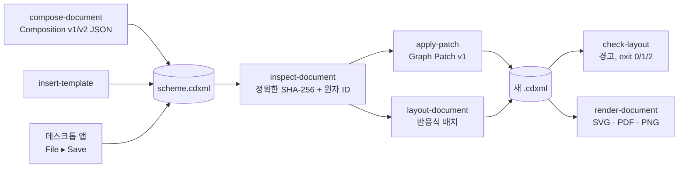
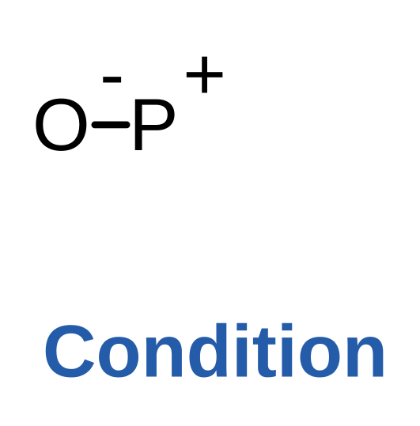
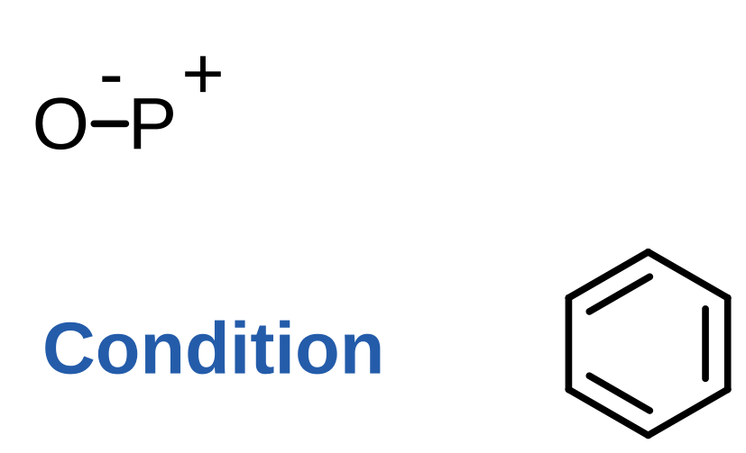
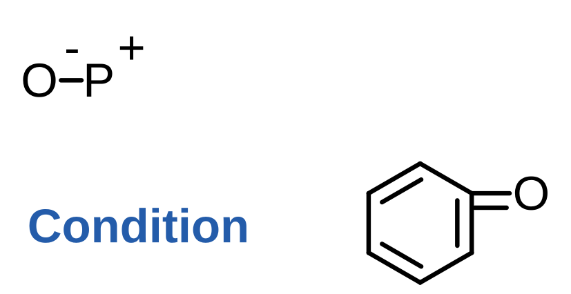

# Chemvas 에이전트 CLI

[English](AGENT_CLI.md)

Chemvas는 GUI 창을 띄우지 않고 문서 작업을 자동화하는 헤드리스 CLI를 제공합니다. 스크립트나 외부 도구는 명령줄에서 문서를 직접 검사, 생성, 패치 수정, 검증, 렌더링할 수 있습니다.

## 명령 파이프라인



CLI 작업의 기본 동작 원칙:
- **비파괴적 파일 생성**: `--output` 경로를 지정하는 명령은 기존 입력을 수정하지 않고 항상 새 파일에 원자적으로 기록합니다.
- **순수 검사**: `inspect-document`와 `check-layout`은 파일 시스템을 변경하지 않고 구조화된 JSON 보고서만 출력합니다.

## 헤드리스 문서 구성 (Composition)

JSON 매니페스트로부터 다시 편집 가능한 유효한 `.cdxml` 문서를 생성합니다:

```bash
chemvas compose-document scheme.json --output scheme.cdxml
```

`images` 배열을 추가하면 PNG/JPEG 래스터 이미지를 캔버스 객체와 함께 내장할 수 있습니다 (경로는 매니페스트 파일 기준 상대 경로; [이미지 객체](IMAGE_OBJECTS.ko.md) 참고).

### 최소 구성 예시

```json
{
  "format": "chemvas-document-composition",
  "version": 1,
  "atoms": [
    {"id": 0, "element": "O", "x": 72.0, "y": 72.0,
     "explicit_label": true, "formal_charge": -1},
    {"id": 1, "element": "P", "x": 92.0, "y": 72.0,
     "formal_charge": 1}
  ],
  "bonds": [{"a": 0, "b": 1, "order": 1}],
  "notes": [
    {"text": "Condition", "x": 64.0, "y": 108.0,
     "style": {"font_size": 12, "font_weight": 700,
               "italic": false, "color": "#245caa"}}
  ]
}
```



- **원자 (Atoms)**: 0부터 시작하는 순차적인 정수 ID를 부여합니다. 선택 속성: `color`, `explicit_label`, `formal_charge`, `radical_electrons`.
- **결합 (Bonds)**: 원자 ID(`a`, `b`)와 차수(`order`), 스타일(`single`, `double`, `wedge`, `hash`), 선택적 색상(`color`)을 지정합니다.
- **노트 및 서식 런 (Runs)**: 일반 텍스트(`text`) 또는 개별 서식이 적용된 조각 배열(`runs`)을 사용합니다:

```json
{
  "x": 64, "y": 108, "style": {"font_size": 12},
  "runs": [
    {"text": "TS", "style": {"font_weight": 700, "italic": true}},
    {"text": "2", "style": {"vertical_align": "sub"}},
    {"text": "‡", "style": {"vertical_align": "super", "color": "#075CAD"}}
  ]
}
```

- **전이 상태 괄호 (TS Brackets)**: 괄호 종류와 캔버스 좌표 범위를 지정합니다:

```json
{"bracket_kind": "square_pair", "left": 40, "top": 40, "right": 160, "bottom": 120}
```

지원 종류: `square_pair`, `parentheses_pair`, `braces_pair`, `square_left`, `parenthesis_left`, `brace_left`, `dagger`, `double_dagger`.

## 레이아웃 진단 및 검사

캔버스 요소 간의 겹침 및 용지 경계 초과 여부를 사전 검사합니다:

```bash
chemvas check-layout scheme.cdxml > layout-report.json
```

주요 진단 경고 코드:
- `text-text-overlap`: 텍스트 노트, 원자 라벨, 화살표 라벨 간의 겹침.
- `text-arrow-overlap`: 텍스트와 화살표 선의 충돌. 독립 노트가 일반선·굵은선·점선과 교차하는 경우도 포함합니다.
- `text-bond-overlap` / `atom-bond-overlap`: 텍스트나 원자 라벨이 분자 결합선과 겹침.
- `charge-bond-overlap`: 형식 전하 표시가 인접 결합선과 교차함.
- `outside-sheet`: 요소가 설정된 캔버스 용지 영역을 벗어남.

대규모 도식에서 용지 경계 초과 여부만 빠르게 검사하려면:

```bash
chemvas check-layout scheme.cdxml --sheet-only > sheet-report.json
```

종료 코드: `0` (정상 통과), `1` (경고 발견), `2` (입력 오류 또는 비정상 실패).

충돌 검사는 그려진 영역의 경계 상자를 공간 인덱스로 좁힌 뒤 실제 경로의
교차를 검사합니다. 배치가 성긴 큰 그림도 모든 객체 쌍의 비용을 미리 부과하지
않고 문서 전체를 검사합니다. 글자 내부의 빈 공간이나 점선의 간격은 충돌로
세지 않으며, 분자에서 서로 연결된 요소를 제외하는 기존 규칙은 유지됩니다.

파일 크기, 객체 수, 텍스트 조판, 공간 탐색, 충돌 후보 쌍과 경로 복잡도에는
계속 제한이 적용됩니다. 한도를 넘으면 종료 코드 `2`와 stderr 오류를 반환하고
불완전한 JSON 보고서를 출력하지 않습니다. `--sheet-only`는 충돌 검사를 생략하지만
도형 생성에 필요한 한도까지 우회하지는 않습니다.

## 고리 템플릿 삽입

RDKit 없이 CLI를 통해 표준 고리 템플릿을 삽입합니다:

```bash
chemvas insert-template scheme.cdxml --request ring.json --dry-run
chemvas insert-template scheme.cdxml --request ring.json --output ring-added.cdxml
```

```json
{
  "format": "chemvas-template-insertion",
  "version": 1,
  "source_sha256": "<64 lowercase hexadecimal characters>",
  "ring_size": 6,
  "style": "benzene",
  "position": [200, 120],
  "anchor": {"kind": "free"}
}
```



지원 스타일: `regular` (고리 크기 3~12), `benzene`, `chair`, `chair_flip`, `boat`. 앵커 종류는 `free`(자유 배치), `atom`(특정 원자 부착), `bond`(결합 융합)를 지원합니다.

## 헤드리스 문서 렌더링

GUI 창을 실행하지 않고 터미널에서 고해상도 SVG, PDF, PNG 또는 실험적 CDXML을 바로 생성합니다:

```bash
chemvas render-document scheme.cdxml --output scheme.svg
chemvas render-document scheme.cdxml --output scheme.pdf --width-mm 174
chemvas render-document scheme.cdxml --output scheme.png --dpi 600
chemvas render-document scheme.cdxml --output journal.svg --width-mm 70 --max-height-mm 120
chemvas render-document scheme.cdxml --output readable.svg --width-mm 174 --min-font-pt 6
chemvas render-document scheme.cdxml --output scheme-transparent.png \
  --background transparent
chemvas render-document scheme.cdxml --output scheme.cdxml --cdxml-label-bindings labels.json
```

- `--width-mm`: 논문 단 너비(1단 84 mm, 2단 174 mm 등)에 맞춰 전체 그림을 비율에 맞게 확대/축소 렌더링합니다.
- `--min-font-pt`: 출력 크기 축소 시 첨자를 포함한 텍스트가 지정한 pt 미만으로 작아지면 출력을 방지합니다.
- `--max-height-mm`: 허용된 세로 높이를 초과하는 그림 출력을 방지합니다.
- `--cdxml-label-bindings`: CDXML 전용. 입력 바이트에 SHA-256으로 결속된 엄격한 JSON sidecar를 읽어 그려진 `Ar`, `Hᵃ` 라벨의 의미를 전달합니다. 자세한 내용은 [CDXML_EXPORT.ko.md](CDXML_EXPORT.ko.md)를 보세요. 형식이 잘못되었거나 결속되지 않았거나 불일치하는 바인딩은 출력 전에 거부합니다.

## Graph Patch v1

문서 전체를 다시 작성하지 않고, 안정적인 원자 ID를 바탕으로 필요한 부분만 수정합니다:

```bash
chemvas inspect-document ring-added.cdxml > inspection.json
chemvas apply-patch ring-added.cdxml patch.json --dry-run
chemvas apply-patch ring-added.cdxml patch.json --output revised.cdxml
```

이중결합을 단일결합으로 줄이고 카보닐기(=O)를 추가하는 패치 예시:

```json
{
  "format": "chemvas-graph-patch",
  "version": 1,
  "source_sha256": "<64 lowercase hexadecimal characters>",
  "operations": [
    {"op": "update_bond", "a": 2, "b": 3,
     "changes": {"order": 1, "style": "single"}},
    {"op": "add_atom", "atom_id": 8, "element": "O",
     "x": 237.32050807568876, "y": 110.0, "color": "#000000", "explicit_label": true},
    {"op": "add_bond", "a": 2, "b": 8, "order": 1,
     "style": "single", "color": "#000000"},
    {"op": "update_bond", "a": 2, "b": 8,
     "changes": {"order": 2, "style": "double"}}
  ]
}
```




지원 연산: `add_atom`, `update_atom`, `move_atom`, `set_terminal_angle`, `add_bond`, `update_bond`, `remove_bond`, `add_note`, `move_note`, `update_note`.

### 노트 생성과 편집

`inspect-document`는 저장된 텍스트·HTML·좌표·회전을 담은 `notes`,
`note_count`, `next_note_index`를 반환합니다. `note_index`는 정확히 그 저장
스냅샷에서 0부터 세는 순서이며 영구 ID가 아닙니다. 검사 결과의 `source_sha256`을
복사하고 문서를 수정해 저장한 뒤에는 다시 검사하세요. 이 조건은
`patch_contract`에도 표시됩니다.

기존 노트가 하나인 문서에서는 `next_note_index`인 `1`을 사용합니다:

```json
{
  "format": "chemvas-graph-patch",
  "version": 1,
  "source_sha256": "<64 lowercase hexadecimal characters>",
  "operations": [
    {"op": "add_note", "note_index": 1,
     "note": {"x": 64, "y": 140, "text": "Condition",
              "style": {"font_size": 12, "color": "#245caa"}}},
    {"op": "move_note", "note_index": 0, "x": 80, "y": 108},
    {"op": "update_note", "note_index": 1,
     "content": {"style": {"font_size": 12}, "runs": [
       {"text": "TS", "style": {"font_weight": 700}},
       {"text": "2", "style": {"vertical_align": "sub"}}
     ]}}
  ]
}
```

- `add_note`는 현재 다음 인덱스에 추가합니다. 같은 패치에서 앞서 추가한 노트도
  계산합니다. `note`는 구성 명령과 같은 `x`, `y`, `text` 또는 `runs`, 선택적
  `style`과 `rotation`을 받습니다.
- `move_note`는 `x`, `y`만 바꿉니다. 저장된 텍스트·HTML, 회전, 노트 순서와
  그룹 참조를 그대로 보존합니다.
- `update_note`는 `text` 또는 `runs`와 선택적 기본 `style`로 내용과 서식 전체를
  교체합니다. 생략한 서식은 구성 명령의 기본값을 사용하며 이전 서식을 상속하지
  않습니다. 색이나 글꼴만 바꾸더라도 원하는 전체 내용을 전달하세요. 좌표·회전·그룹
  참조는 유지됩니다.

구성 명령과 같은 검증기와 서식 직렬화기를 사용하며, 원시 HTML 패치나 암묵적
서식 병합은 받지 않습니다. 검사 및 패치 보고에는 노트 개수도 포함됩니다.
그래프 연산과 마찬가지로 dry run은 후보 문서 전체를 검증하고 실제 출력은 새
파일로 만듭니다. 데스크톱에서 열면 일반 노트처럼 편집하고 이후 편집의 Undo/Redo와
저장·재열기를 사용할 수 있습니다. CLI가 이미 열린 창의 이력에 작업을 넣지는 않습니다.

### 패치 작성을 위한 원자 ID 조회

문서의 원자 ID와 SHA-256 해시를 빠르게 조회하는 스크립트:

```bash
python - <<'PY'
import hashlib, json
from pathlib import Path
data = Path("drawing.cdxml").read_bytes()
model = json.loads(data)["state"]["model"]
print(json.dumps({"source_sha256": hashlib.sha256(data).hexdigest(),
                  "atoms": model["atoms"], "bonds": model["bonds"]}, indent=2))
PY
```

원자 라벨을 변경하는 단일 연산:

```json
{"op":"update_atom", "atom_id":1, "changes":{"element":"O"}}
```

### 말단기 결합 각도 수정

말단 치환기의 결합 방향을 각도로 지정합니다:

```json
{"op":"set_terminal_angle", "pivot_id":6, "reference_id":2,
 "terminal_id":7, "angle_degrees":-120}
```

## 저장된 계산 계획

Chemvas는 화학 백엔드를 설치하지 않으며 `machine.json`을 쓰지 않습니다.
`.cdxml`에 이미 저장된 계산 계획은 현재 그림과 맞을 때 유지됩니다.
현재 그림을 저장하면 그 계획이 빠지는 경우 저장은 거부됩니다.
반응 매핑 패널과, 계획을 만들거나 내보내는 명령은 없습니다.
그래프 검사는 `inspect-document`입니다.


## 용지 크기

흰 사각형을 그려 용지를 대신하지 말고 composition의 `settings`에 용지 크기를
지정합니다. 기본은 A4 가로이며 A0–A5, Letter, Legal, Tabloid를 지원합니다.

```json
{
  "settings": {"sheet_size": "A3", "sheet_orientation": "landscape"}
}
```

사용자 지정은 각 변 10–3000 mm의 실제 가로·세로를 지정합니다.
`sheet_orientation`은 표준 용지에만 적용됩니다.

```json
{
  "settings": {
    "sheet_size": "Custom",
    "sheet_orientation": "landscape",
    "sheet_custom_size_mm": [600, 400]
  }
}
```

좌표 원점은 용지 중앙이며 1인치는 72 drawing units입니다. 600 × 400 mm 용지는
약 ±850.39 × ±566.93 범위입니다. 라벨과 선 여백을 남기고
`check-layout --sheet-only`로 확인합니다. 크기를 바꿔도 그림 좌표는 유지됩니다.
