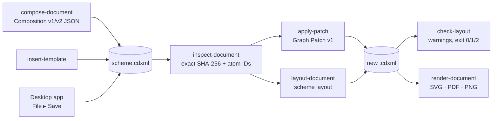

# Chemvas agent CLI

[한국어](AGENT_CLI.ko.md)

Chemvas provides a headless CLI for automating document operations without launching a graphical Qt window. Automation scripts and external tools can programmatically inspect, compose, patch, validate, and render documents.

## Command Workflow



All CLI operations enforce explicit validation contracts:
- **Non-destructive**: Commands taking an `--output` path write atomically to a new destination without modifying input files.
- **Pure Inspection**: `inspect-document` and `check-layout` output structured JSON reports without writing any files to disk.

## Headless document composition

Generate valid, editable `.cdxml` documents from structured JSON manifests:

```bash
chemvas compose-document scheme.json --output scheme.cdxml
```

The optional `images` array embeds PNG/JPEG rasters alongside native canvas objects. Paths are relative to the manifest file (see [Image Objects](IMAGE_OBJECTS.md)).

### Minimal Composition Example

```json
{
  "format": "chemvas-document-composition",
  "version": 1,
  "atoms": [
    {"id": 0, "element": "O", "x": 72.0, "y": 72.0,
     "explicit_label": true, "formal_charge": -1},
    {"id": 1, "element": "P", "x": 92.0, "y": 72.0,
     "formal_charge": 1}
  ],
  "bonds": [{"a": 0, "b": 1, "order": 1}],
  "notes": [
    {"text": "Condition", "x": 64.0, "y": 108.0,
     "style": {"font_size": 12, "font_weight": 700,
               "italic": false, "color": "#245caa"}}
  ]
}
```


- **Atoms**: IDs must be sequential starting from 0. Optional fields: `color`, `explicit_label`, `formal_charge`, `radical_electrons`.
- **Bonds**: Specifies connections between atom IDs (`a`, `b`) with `order` (1, 2, 3), `style` (`single`, `double`, `wedge`, `hash`), and optional `color`.
- **Notes & Runs**: Notes accept either plain `text` or rich-text `runs`:

```json
{
  "x": 64, "y": 108, "style": {"font_size": 12},
  "runs": [
    {"text": "TS", "style": {"font_weight": 700, "italic": true}},
    {"text": "2", "style": {"vertical_align": "sub"}},
    {"text": "‡", "style": {"vertical_align": "super", "color": "#075CAD"}}
  ]
}
```

- **Transition State Brackets**: Specify bracket kind and bounding coordinates:

```json
{"bracket_kind": "square_pair", "left": 40, "top": 40, "right": 160, "bottom": 120}
```

Supported kinds: `square_pair`, `parentheses_pair`, `braces_pair`, `square_left`, `parenthesis_left`, `brace_left`, `dagger`, and `double_dagger`.

## Headless layout diagnostics

Validate layout geometry, boundary containment, and overlapping elements:

```bash
chemvas check-layout scheme.cdxml > layout-report.json
```

Common diagnostic codes reported:
- `text-text-overlap`: Overlapping text notes, atom labels, or arrow labels.
- `text-arrow-overlap`: Text colliding with arrow strokes, including standalone notes crossing plain, bold or dashed lines.
- `text-bond-overlap` / `atom-bond-overlap`: Text or atom labels colliding with molecular bonds.
- `charge-bond-overlap`: Formal charge marks intersecting adjacent bonds.
- `outside-sheet`: Canvas elements extending beyond page boundaries.

For quick sheet boundary checks on complex schemes:

```bash
chemvas check-layout scheme.cdxml --sheet-only > sheet-report.json
```

Exit codes: `0` (clean), `1` (warnings detected), `2` (invalid document or error).

Collision checks use a spatial index of painted bounds, then intersect the actual
painted paths. Sparse figures are checked as a whole without charging for every
possible object pair. Glyph holes and dash gaps do not count as painted overlap.
Existing molecular adjacency exclusions remain in effect.

Resource limits still apply to file size, object count, text shaping, spatial
search, candidate pairs and path complexity. A budget failure returns exit `2`
with an explanation on stderr and no partial JSON report. `--sheet-only` omits
collision checks; it cannot bypass limits needed to construct the geometry.

## Native ring templates

Insert standardized ring templates via CLI without requiring RDKit:

```bash
chemvas insert-template scheme.cdxml --request ring.json --dry-run
chemvas insert-template scheme.cdxml --request ring.json --output ring-added.cdxml
```

```json
{
  "format": "chemvas-template-insertion",
  "version": 1,
  "source_sha256": "<64 lowercase hexadecimal characters>",
  "ring_size": 6,
  "style": "benzene",
  "position": [200, 120],
  "anchor": {"kind": "free"}
}
```


Supported styles: `regular` (sizes 3–12), `benzene`, `chair`, `chair_flip`, and `boat`. Anchors can be `free`, bound to an `atom`, or fused onto a `bond`.

## Headless document rendering

Render publication-ready figures directly to SVG, PDF, PNG, or experimental CDXML without launching the desktop GUI:

```bash
chemvas render-document scheme.cdxml --output scheme.svg
chemvas render-document scheme.cdxml --output scheme.pdf --width-mm 174
chemvas render-document scheme.cdxml --output scheme.png --dpi 600
chemvas render-document scheme.cdxml --output journal.svg --width-mm 70 --max-height-mm 120
chemvas render-document scheme.cdxml --output readable.svg --width-mm 174 --min-font-pt 6
chemvas render-document scheme.cdxml --output scheme-transparent.png \
  --background transparent
chemvas render-document scheme.cdxml --output scheme.cdxml --cdxml-label-bindings labels.json
```

- `--width-mm`: Scales the figure to fit specific column widths (e.g., 84 mm for single column, 174 mm for double column).
- `--min-font-pt`: Ensures rendered font sizes (including subscripts) remain readable.
- `--max-height-mm`: Rejects figures exceeding vertical layout limits.
- `--cdxml-label-bindings`: CDXML only. Reads a strict JSON sidecar, bound to the exact input bytes by SHA-256, that states the meaning of drawn `Ar` and `Hᵃ` labels; see [CDXML_EXPORT.md](CDXML_EXPORT.md). Any malformed, unbound or mismatched binding is refused before output.

## Graph Patch v1

Inspect stable atom IDs and apply targeted graph mutations without rewriting the entire document:

```bash
chemvas inspect-document ring-added.cdxml > inspection.json
chemvas apply-patch ring-added.cdxml patch.json --dry-run
chemvas apply-patch ring-added.cdxml patch.json --output revised.cdxml
```

Example patch reducing a double bond and adding a carbonyl group:

```json
{
  "format": "chemvas-graph-patch",
  "version": 1,
  "source_sha256": "<64 lowercase hexadecimal characters>",
  "operations": [
    {"op": "update_bond", "a": 2, "b": 3,
     "changes": {"order": 1, "style": "single"}},
    {"op": "add_atom", "atom_id": 8, "element": "O",
     "x": 237.32050807568876, "y": 110.0, "color": "#000000", "explicit_label": true},
    {"op": "add_bond", "a": 2, "b": 8, "order": 1,
     "style": "single", "color": "#000000"},
    {"op": "update_bond", "a": 2, "b": 8,
     "changes": {"order": 2, "style": "double"}}
  ]
}
```


Supported operations: `add_atom`, `update_atom`, `move_atom`, `set_terminal_angle`, `add_bond`, `update_bond`, `remove_bond`, `add_note`, `move_note`, `update_note`.

### Creating and editing notes

`inspect-document` returns `notes` (saved text, HTML, position and rotation),
`note_count` and `next_note_index`. Each `note_index` is the zero-based position
in that exact saved snapshot, not a persistent identity. Copy `source_sha256`
from inspection and inspect again after saving a changed document. The
`patch_contract` describes this requirement.

For a source with one existing note, use its `next_note_index` of `1`:

```json
{
  "format": "chemvas-graph-patch",
  "version": 1,
  "source_sha256": "<64 lowercase hexadecimal characters>",
  "operations": [
    {"op": "add_note", "note_index": 1,
     "note": {"x": 64, "y": 140, "text": "Condition",
              "style": {"font_size": 12, "color": "#245caa"}}},
    {"op": "move_note", "note_index": 0, "x": 80, "y": 108},
    {"op": "update_note", "note_index": 1,
     "content": {"style": {"font_size": 12}, "runs": [
       {"text": "TS", "style": {"font_weight": 700}},
       {"text": "2", "style": {"vertical_align": "sub"}}
     ]}}
  ]
}
```

- `add_note` appends at the current next index, including earlier additions in
  the same patch. Its `note` accepts the composition contract: `x`, `y`, either
  `text` or rich `runs`, optional `style`, and optional `rotation`.
- `move_note` changes only `x` and `y`; it preserves the exact saved text/HTML,
  rotation, note order and group references.
- `update_note` replaces the entire content and style with either `text` or
  `runs` and an optional base `style`. Omitted styles use composition defaults;
  they do not inherit the old formatting. Supply the full desired content when
  changing only a color or font. Position, rotation and group references remain.

Notes use the same validation and rich-text serializer as composition. No raw
HTML patch or implicit formatting merge is accepted. Inspect and patch reports
include note counts. As with graph operations, dry runs validate the complete
candidate and writes create a new file. Opening that file in the desktop uses
normal editable notes, Undo/Redo for subsequent edits, and native save/reopen;
the CLI does not insert an action into an already open window's history.

### Inspecting IDs for Patching

To extract atom IDs and compute SHA-256 for a patch request:

```bash
python - <<'PY'
import hashlib, json
from pathlib import Path
data = Path("drawing.cdxml").read_bytes()
model = json.loads(data)["state"]["model"]
print(json.dumps({"source_sha256": hashlib.sha256(data).hexdigest(),
                  "atoms": model["atoms"], "bonds": model["bonds"]}, indent=2))
PY
```

Example operation to update an atom label:

```json
{"op":"update_atom", "atom_id":1, "changes":{"element":"O"}}
```

### Adjusting Terminal Angles

Adjust terminal substituent orientation programmatically:

```json
{"op":"set_terminal_angle", "pivot_id":6, "reference_id":2,
 "terminal_id":7, "angle_degrees":-120}
```

## Stored calculation plans

Chemvas does not install a chemistry backend and does not write `machine.json`.
A calculation plan already stored in a `.cdxml` file is kept when it still
matches the drawing. Save refuses when the current drawing would drop that plan.
There is no reaction-mapping panel and no command that creates or exports a plan.
Graph inspection is `inspect-document`.

### Paper size

Set the paper in the composition's `settings`; do not add a white rectangle to
simulate a larger page. The default remains A4 landscape. Available presets are
`A0`, `A1`, `A2`, `A3`, `A4`, `A5`, `Letter`, `Legal`, and `Tabloid`:

```json
{
  "settings": {"sheet_size": "A3", "sheet_orientation": "landscape"}
}
```

For exact width and height, use `Custom` and millimetres (10–3000 per side):

```json
{
  "settings": {
    "sheet_size": "Custom",
    "sheet_orientation": "landscape",
    "sheet_custom_size_mm": [600, 400]
  }
}
```

Custom dimensions are the actual width and height; orientation only changes
presets. Coordinates remain centered on `(0, 0)`, at 72 drawing units per inch.
For example, a 600 × 400 mm page spans approximately ±850.39 × ±566.93 units.
Leave space for labels and strokes, then run `check-layout --sheet-only`.
Changing paper dimensions does not translate or scale drawing objects. These
settings are retained by document editing and shared desktop/headless rendering.
