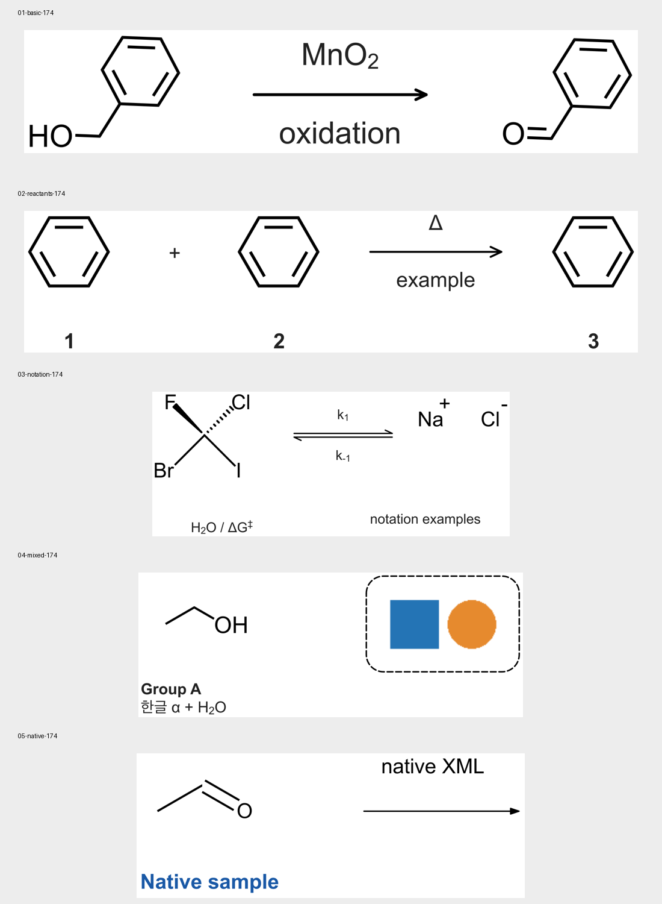

# 출시 검증 문서

[English](README.md) · [플랫폼 검증 기준](../../docs/RELEASE_ACCEPTANCE.ko.md)

각 대상 OS에 설치한 앱에서 아래 CDXML 다섯 개를 엽니다. `Chemvas 한글 checks/`처럼
한글과 공백이 있는 새 디렉터리에 사본을 만들어 사용합니다. 원본과
[SHA256SUMS](SHA256SUMS)가 기준이며, 원본 위에 저장하지 않습니다.

모두 공개용 합성 예제이며 반응이나 실험의 근거가 아닙니다. `01-basic`은 저장소의
`first-scheme.cdxml`을 바탕으로 만들었고, `02`–`04`는 Chemvas 0.27.1로 구성해
CDXML로 저장했습니다. `04`의 이미지는 직접 생성한 파란 사각형과 주황 원입니다.
`05`는 Chemvas 스냅샷 없이 직접 작성한 네이티브 CDXML이며 **ChemDraw에서 내보낸
파일이 아닙니다**. 실제 ChemDraw 교환은 별도 문서와 검증 기록이 필요합니다.



미리보기는 육안 비교용입니다. OS 간 픽셀 일치를 합격 기준으로 삼지 않습니다.

## 원본의 기대 결과와 편집 과제

개수는 원본 기준입니다. 글꼴 대체로 크기는 달라질 수 있지만 기호가 사라지거나
의미가 바뀌면 안 됩니다. 파일이 열려도 구조·전하·그룹·이미지가 달라졌다면 실패입니다.

| 파일 | 원본의 기대 결과 | GUI 편집 과제 |
| --- | --- | --- |
| [01-basic.cdxml](01-basic.cdxml) | 벤젠을 포함한 구조 두 개, 원자 16개·결합 16개, 화살표 1개. 위 MnO₂, 아래 `oxidation`. | 아래 라벨을 `oxidation check`로 바꾸고 화살표를 이동합니다. 두 라벨이 함께 따라와야 합니다. |
| [02-reactants.cdxml](02-reactants.cdxml) | 독립 벤젠 구조 세 개, 원자 18개·결합 18개. 각 구조 아래 `1`, `2`, `3`, 앞 두 구조 사이 더하기 기호, 세 번째로 향하는 화살표. | 구조와 해당 캡션을 함께 옮깁니다. Arrange Scheme에서 더하기 connector로 정렬해 각 캡션이 자기 구조 아래에 남는지 확인합니다. |
| [03-notation.cdxml](03-notation.cdxml) | 원자 7개·결합 4개. F로 향하는 쐐기와 Cl로 향하는 해시 결합, 별도 Na⁺와 Cl⁻. 평형 화살표에 k₁·k₋₁. 노트 H₂O / ΔG‡에서 2는 아래첨자, ‡는 위첨자. | 입체 구조를 옮기고 노트·화살표 라벨에 서식을 적용한 뒤 실행 취소/다시 실행합니다. 전하와 쐐기·해시의 끝점이 유지되어야 합니다. |
| [04-mixed.cdxml](04-mixed.cdxml) | 원자 3개·결합 2개. 구조와 두 줄 노트 `Group A` / `한글 α + H₂O`가 한 그룹. 120×60 내장 이미지의 왼쪽은 파란 사각형, 오른쪽은 주황 원. 별도의 점선 둥근 사각형. | 그룹을 옮기면 구조와 노트만 함께 움직여야 합니다. 이미지의 비율을 유지하며 크기를 바꾸고 실행 취소/다시 실행합니다. |
| [05-native.cdxml](05-native.cdxml) | 원자 3개·결합 2개, O로 향하는 이중결합, 노트 2개, 화살표 1개. `Native sample`은 파란 굵은 글씨, `native XML`은 검정. 원본 fragment의 선 굵기와 이중결합 간격 유지. | `Native sample`을 `Native edited`로 고치고 사본을 저장해 다시 엽니다. 글자가 편집 가능하고 파란색이며 구조 스타일도 유지되어야 합니다. |

`02`의 Arrange Scheme 블록은 원자 ID 0–5, 6–11, 12–17과 캡션 0, 1, 2를
사용합니다. connector는 `[["notes", 3], ["arrows", 0]]`입니다. 인덱스는 원본에서
0부터 셉니다. [레이아웃 요청 형식](../../docs/SCHEME_LAYOUT.ko.md)을 따르고,
새로 저장한 파일로 CLI 요청을 만들 때는 다시 검사하여 `source_sha256`을 맞춥니다.

## 모든 플랫폼에서 같은 순서로 확인

1. 사본을 열고 편집 전에 표의 모든 요소를 대조합니다.
2. 편집 과제를 수행하고 실행 취소·다시 실행합니다. 의도한 변경을 화면 캡처나
   짧은 설명으로 남기고 무관한 요소가 그대로인지 확인합니다.
3. 새 `.cdxml`로 저장하고 앱을 종료합니다. 앱을 다시 실행해 저장한 문서를 열고,
   전체 그림과 편집 가능 상태를 기록한 기대 결과와 대조합니다.
4. SVG·PDF·PNG를 **84 mm**, **174 mm**로 출력합니다. PNG는 **300 DPI**로
   설정합니다. 별도 뷰어로 열고 원고에 해당 너비로 넣어 전하·첨자·입체 결합·캡션·
   이미지·한글과 기호를 확인합니다.
5. 원본의 체크섬이 같은지 확인합니다. 문서별 후보 커밋, 배포물 해시, OS·CPU·
   화면 백엔드, 실제 글꼴, 결과와 근거를 기록합니다.

이 절차로 설치·업데이트·제거, 중단 후 복구, 저장 실패 검증을 대신할 수 없습니다.
레이아웃 검사 성공은 보고서에 적힌 충돌 범위만 다루며, 화학적 정확성이나 최종
출력 크기에서의 가독성을 보장하지 않습니다.

## CLI로 함께 확인

이 디렉터리에서 설치된 `chemvas` 명령으로 실행합니다. Windows 번들은
`chemvas-cli.exe`, 다른 번들은 제공된 CLI 진입점을 사용합니다. 출력은 덮어쓰기를
거부하므로 매번 **새 출력 디렉터리**를 만듭니다. 다섯 입력 파일에 같은 인자를 적용합니다.

```sh
mkdir check-output
chemvas inspect-document 01-basic.cdxml
chemvas check-layout 01-basic.cdxml
chemvas render-document 01-basic.cdxml --output check-output/basic-84.svg --width-mm 84 --min-font-pt 6
chemvas render-document 01-basic.cdxml --output check-output/basic-84.pdf --width-mm 84
chemvas render-document 01-basic.cdxml --output check-output/basic-84.png --width-mm 84 --dpi 300 --min-font-pt 6
chemvas render-document 01-basic.cdxml --output check-output/basic-174.svg --width-mm 174 --min-font-pt 6
chemvas render-document 01-basic.cdxml --output check-output/basic-174.pdf --width-mm 174
chemvas render-document 01-basic.cdxml --output check-output/basic-174.png --width-mm 174 --dpi 300 --min-font-pt 6
```

SVG·PNG 명령은 글꼴 보고서가 다루는 표시 텍스트와 첨자에 최소 6 pt를 요구합니다.
PDF는 이 옵션을 지원하지 않으므로 육안으로 확인합니다. 6 pt는 이 예제 묶음의 기본 기준이며, 저널이 더 큰 글자를 요구하면 해당 기준을 적용하고
실제 출력된 글리프도 육안으로 확인합니다.

Qt는 SVG·PDF 페이지 크기를 정수 포인트로 반올림합니다. 이 두 출력 설정에서는
요청 너비에서 0.18 mm(약 0.5 pt)까지 허용합니다. 현재 실측값은 각각
83.961 mm / 238 pt, 173.919 mm / 493 pt입니다. 300 DPI PNG 너비는 반올림
1픽셀 이내로 각각 992, 2055픽셀이어야 합니다. 실제 크기를 기록하고, 출력 성공만으로
글자 모양과 가독성을 판정하지 않습니다.

소스 체크아웃에서는 기존의 파일별 검사 명령으로 예제의 객체 수·특징·전체 상태의
저장 및 재열기를 확인할 수 있습니다.

```sh
bash scripts/check.sh tests/test_release_validation_documents.py
```

이는 선별 소스 검사이며 설치된 번들의 인증이 아닙니다. 출시 대상의 설치·네이티브
GUI 결과는 모두 **미완료**에서 시작합니다.
